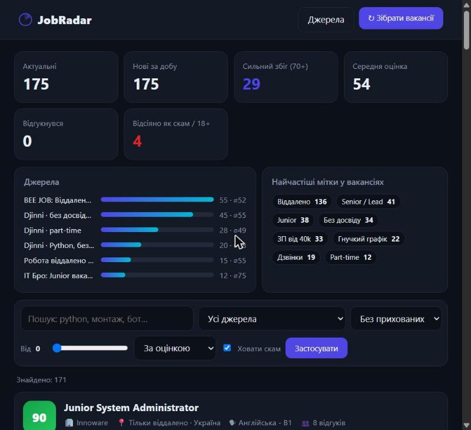
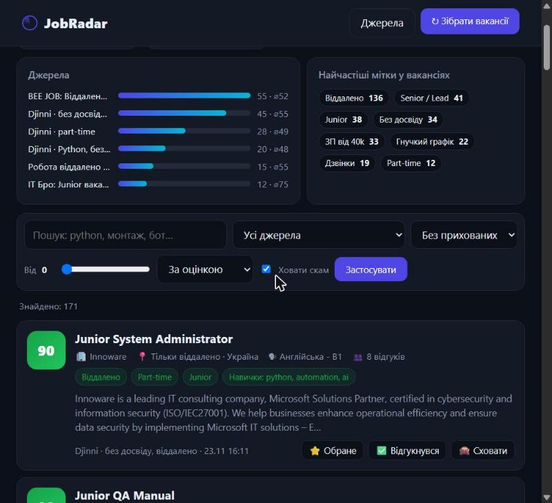

# JobRadar — парсер вакансій з оцінкою під ваш профіль

Django-застосунок, який збирає вакансії з **Djinni** і **Telegram-каналів**, оцінює кожну за шкалою 0–100
під профіль кандидата (студент, вечір / part-time, без великого досвіду, власні навички),
відсіює скам і 18+, показує все в дашборді й надсилає найкращі нові вакансії в Telegram.

Зробив для власного пошуку роботи: замість щоденного гортання десятків каналів — один список,
відсортований за тим, наскільки вакансія справді підходить.



## Можливості

**Парсери** (`radar/scrapers/`)
- **Djinni** — HTML-сторінки пошуку (requests + BeautifulSoup): посада, компанія, зарплата, локація,
  досвід, англійська, кількість відгуків, дата; пагінація;
- **Telegram** — публічні веб-превʼю каналів `t.me/s/<канал>`: гортання назад сторінками до заданої давнини,
  відсіювання реклами й анонсів, назва вакансії з першого змістовного рядка (дайджест-заголовки пропускаються);
- ввічливий збір: власний User-Agent, пауза між запитами, ліміт сторінок, лише дозволені robots.txt розділи;
- розпізнавання зарплати у вільному тексті («від 25 000 – 45 000 грн», «$500–800»), конвертація в гривні,
  захист від хибних збігів (телефони, роки).

**Оцінка вакансій** (`radar/scoring.py`) — прозорі правила з мітками, тож видно, *чому* така оцінка:
- плюс: віддалено, part-time, гнучкий графік, вечір / ніч, без досвіду, junior, студентам, ваші навички, висока ЗП;
- мінус: дзвінки, жорсткий 5/2 вдень, досвід 2+ роки, senior / lead, відеоефіри;
- червоні прапорці (оцінка 0, приховуються): передоплата, «дропи», казино, OnlyFans / вебкам.

**Збереження** (`radar/services.py`)
- `update_or_create` без дублікатів: повторний збір оновлює дані, але **не перезаписує статус**, який виставив користувач;
- зламане джерело не зупиняє інші — помилка зберігається й видна в дашборді.

**Telegram-сповіщення** (`radar/notify.py`) — лише нові вакансії з оцінкою від `NOTIFY_MIN_SCORE`,
через Bot API без зайвих бібліотек, з обробкою flood control (429).

**Дашборд**
- KPI, розподіл за джерелами із середньою оцінкою, найчастіші мітки;
- пошук, фільтри за джерелом, статусом і мінімальною оцінкою, сортування за оцінкою / датою / зарплатою;
- статуси «Обране», «Відгукнувся», «Приховано» одним кліком (AJAX, CSRF);
- кнопка «Зібрати вакансії» запускає збір у фоні; світла й темна тема, адаптив під телефон.

**Django admin** — керування джерелами (додати канал чи пошук Djinni) і вакансіями.



## Стек
Python 3.11+ · Django 5 · requests · BeautifulSoup4 · SQLite · Telegram Bot API · HTML / CSS / JS

## Запуск
```bash
python -m venv .venv
.venv\Scripts\activate             # Linux/macOS: source .venv/bin/activate
pip install -r requirements.txt
copy .env.example .env             # Linux/macOS: cp .env.example .env
python manage.py migrate
python manage.py seed_sources      # стартові джерела: 3 пошуки Djinni + 3 Telegram-канали
python manage.py scrape            # збір, оцінка, сповіщення
python manage.py runserver
```
Дашборд: http://127.0.0.1:8000/ · адмінка: http://127.0.0.1:8000/admin/ (`python manage.py createsuperuser`).

Інші команди:
- `python manage.py scrape --no-notify --source 2` — без сповіщень, лише вибрані джерела;
- `python manage.py rescore` — переоцінити все після зміни `PROFILE_SKILLS` чи правил.

Для автоматичного збору додайте `python manage.py scrape` у cron / Планувальник завдань Windows, напр. раз на 2 години.

## Тести
```bash
python manage.py test radar
```
19 тестів: парсери Djinni й Telegram на синтетичному HTML, розпізнавання зарплати, правила оцінки,
збереження без дублікатів і збереження статусу користувача, обробка зламаного джерела,
сповіщення лише для сильних вакансій, фільтри й API статусів дашборду.

## Структура
```
config/                 налаштування, URL
radar/
  scrapers/             base.py (сесія, зарплата), djinni.py, telegram.py
  scoring.py            оцінка 0–100 з мітками й червоними прапорцями
  services.py           збір → оцінка → збереження → сповіщення
  notify.py             Telegram Bot API
  views.py, templates/  дашборд
  management/commands/  scrape, seed_sources, rescore
  tests/                тести
```

## Обмеження й чесні нотатки
- Work.ua і robota.ua закриті антибот-захистом — їх свідомо не парсимо, а обходити захист не будемо.
- Дайджест-пости з кількома вакансіями (напр. «Актуальні вакансії» з 5 позиціями) зберігаються як одна вакансія з назвою першої позиції.
- Дашборд розрахований на локальне використання; для публічного деплою варто закрити його авторизацією.

---
Автор: Ілля Мірошников · Telegram [@m0onbl0od](https://t.me/m0onbl0od) · інші проєкти: [github.com/moonblo0d](https://github.com/moonblo0d)
